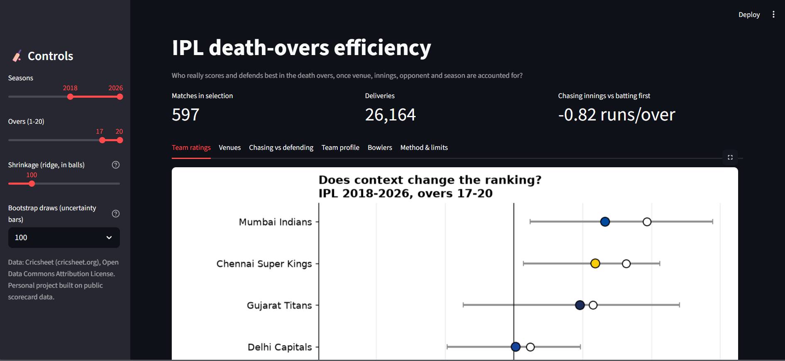
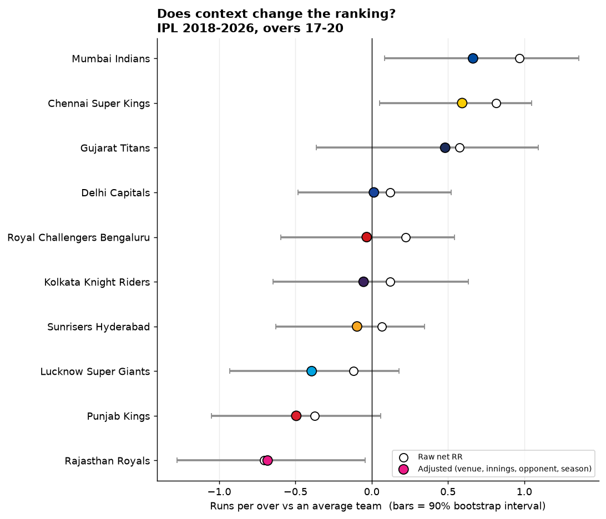

# IPL Death-Overs Efficiency Analysis

**Live app:** https://ipl-death-overs-analysis.streamlit.app/



Open-data project using [Cricsheet](https://cricsheet.org) ball-by-ball IPL data (ODC-By) to measure
how well each franchise **bats and bowls in overs 17-20**.

> **Why not bowler release-point variation?** Cricsheet only has scorecard-level ball data. Release points
> need ball-tracking data (Hawk-Eye etc.), which is not openly available.

## Quick start

```bash
pip install -r requirements.txt
python download_data.py            # fetches ~1,200+ IPL matches into data/raw
python run_analysis.py             # all seasons, overs 17-20
python run_analysis.py --from-season 2018 --team "Chennai Super Kings" --team "Mumbai Indians"
```

No internet? `python make_sample_data.py && python run_analysis.py --raw data/sample` runs on
**synthetic** matches (not real results) to demo the pipeline.

## Interactive app

```bash
python build_app_data.py           # once: builds app_data/ipl_deliveries.csv.gz from the parsed data
python -m streamlit run app.py
```

Explore team ratings, venue effects, chasing vs defending, team profiles and death-over bowlers, with
controls for season range and over range (so you can compare the powerplay too).

Live app: https://ipl-death-overs-analysis.streamlit.app/
(If the app has been idle it may be asleep; click the wake-up button and give it a few seconds.)

## Key findings (IPL 2018-2026, overs 17-20)



- Mumbai Indians (+0.66 runs/over, 90% interval 0.08 to 1.36) and Chennai Super Kings (+0.59, 0.05 to 1.05) are the only clearly above-average death-overs teams after adjusting for venue, innings, opponent and season.
- Rajasthan Royals (-0.68, -1.28 to -0.04) are the only clearly below-average team, mainly because of bowling.
- Eden Gardens (+1.38) and Chinnaswamy (+0.99) inflate death-over scoring; Sheikh Zayed, Sharjah and Chepauk suppress it. The UAE grounds hosted games mainly in 2020-21, so treat them with caution.
- The other seven teams cannot be statistically separated from average.

## Metrics

| Metric | Definition |
|---|---|
| Batting RR | team runs per over in the death overs (legal balls) |
| Bowling economy | runs charged to bowler (excludes byes/leg byes) per over |
| **Net RR** | batting RR - bowling economy; the headline efficiency number |
| Boundary % / Dot % | share of legal balls that went for 4/6 or 0 runs |
| Balls per wicket | balls / wickets (bowler-credited wickets for bowling) |

## Outputs (`outputs/`)

1. `01_net_run_rate.png`: team ranking by net death-over run rate
2. `02_bat_vs_bowl.png`: quadrant chart, hitting vs defending
3. `03_season_heatmap.png`: team x season net RR
4. `04_over_progression.png`: run rate by over for top teams vs league
5. `05_top_bowlers.png`: best death bowlers (economy vs dot %, size = wickets)
6. `06_profile_<team>.png`: 4-panel team dashboard (`--team`)
7. `07_adjusted_vs_raw.png`: **raw vs context-adjusted** net rating with 90% bootstrap intervals
8. `08_chase_vs_defend.png`: batting setting vs chasing, bowling first vs defending
9. `09_venue_effects.png`: which grounds inflate or suppress death-over scoring
10. CSVs: `team_efficiency.csv`, `team_efficiency_by_season.csv`, `team_efficiency_adjusted.csv`,
    `venue_effects.csv`, `chase_vs_defend.csv`, `death_bowlers.csv`

## Project structure

| File | Purpose |
|---|---|
| `download_data.py` | downloads the Cricsheet IPL JSON archive |
| `death_overs/parse.py` | parses match JSON into a ball-level table (teams, venues, wickets, extras) |
| `death_overs/metrics.py` | raw batting, bowling and net run-rate metrics; chase/defend split |
| `death_overs/adjust.py` | context-adjusted ridge model with bootstrap intervals |
| `death_overs/plots.py` | all charts |
| `run_analysis.py` | command-line entry point, writes charts and CSVs to `outputs/` |
| `build_app_data.py` | builds the compact data file the app loads |
| `app.py` | Streamlit app |
| `make_sample_data.py` | synthetic matches for offline testing (not real results) |

## Data-handling notes

- Seasons come from the match date's calendar year (so "2007/08" -> 2008, "2020/21" -> 2020).
- Franchise renames are merged (Delhi Daredevils -> Delhi Capitals, Kings XI -> Punjab Kings, RCB Bangalore -> Bengaluru).
  Edit `TEAM_ALIASES` in `death_overs/parse.py` to change this.
- Super overs and rain-shortened matches (`overs != 20`) are excluded.
- Run outs / retired are not credited to bowlers.
- The parsed deliveries are cached to CSV; use `--refresh` after adding new matches.
- `app_data/ipl_deliveries.csv.gz` is a compact derivative of the Cricsheet data, kept in the repo so the app can be deployed.

## Context adjustment (venue, chasing vs defending, opposition)

Raw numbers are confounded. A side that plays 40% of its games at a small ground looks like a great hitting
team, and a side that keeps facing weak lineups looks like a great bowling team. `death_overs/adjust.py` fits

```
runs per over (death phase of one innings)
   = intercept + chasing + batting_team + bowling_team + venue + season
```

with **weighted ridge regression** (weight = legal balls), so each team's batting and bowling effect is measured
*holding venue, innings, opponent and season fixed*.

- `bat_effect`: extra runs/over scored vs an average team in the same context
- `bowl_effect`: runs/over saved vs an average team in the same context
- `adj_net = bat_effect + bowl_effect`, with a 90% interval from a match-level bootstrap
- `--ridge` (default 100 balls) shrinks thin-sample teams and venues toward average; raise it for noisier slices
- `--min-venue-innings` pools rarely used venues as "Other venues"; `--bootstrap 0` turns intervals off
- The printed venue table is there so you can spot duplicate venue names and extend `VENUE_ALIASES` in `parse.py`

The chasing coefficient is printed in the console summary.

## Remaining limitations

- **Chasing innings are truncated** when the target is reached, so chase death-overs are over-represented by
  close games; the chase vs defend chart is descriptive, not causal.
- **Players are not modelled.** Squads change every season, so team effects blend old and new rosters. Try
  `--from-season` windows, or fit the same model with bowler/batter effects as an extension.
- **Pitch/weather/dew, toss and match state (wickets in hand, required rate) are not controlled.**
- Effects are linear and additive; a strong bowler at a flat ground may not behave additively.
- Intervals reflect sampling noise only, not model misspecification.

Ideas: batter-vs-bowler matchups, pace vs spin (needs a bowler-type lookup), win-probability added in the death.

## Credits

Data: Cricsheet (https://cricsheet.org), made available under the Open Data Commons Attribution License (ODC-By).
Charts in `outputs/` were generated from real IPL data (2018-2026) with `python run_analysis.py --from-season 2018`.

Personal project built on public scorecard data; not affiliated with the BCCI or the IPL.
